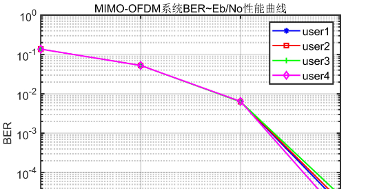

# MIMO-OFDM radar communication system algorithm MATLAB code

Firstly, establish MIMO and OFDM. At the receiving end, utilize two transmit antennas and employ a cyclic prefix in OFDM. The modulation methods are compared and analyzed using QPSK/8PSK/16QAM/64QAM. The carrier frequency is set at 5GHz.
System implementation steps:
Transmitter:
1. Transmitter sends data, randomly generates bitstream without channel coding.
2. Subcarrier allocation.
3. Add modulation: QPSK/8PSK/16QAM/64QAM.
4. STBC space-time coded.
5. Add pilot.
6. OFDM modulation.
7. Gaussian channel, simulation SNR: 0:5:20dB.
Receiver:
1. OFDM demodulation.
2. Space-time coded decoding.
3. Demodulation (QPSK/8PSK/16QAM/64QAM four modes).
4. Find corresponding frame transmission bitstream to calculate error rate.
Simulation experiment:
Under the high SNR Gaussian channel of 0:5:20dB, compare the performance of MIMO-OFDM with four users (two transmitters and two receivers) without different modulation methods (through error rate). The following four figures are obtained:
%-----------------------MIMO-OFDM main function---------------------%\n%-----------------------author:users  --------------------------%\n%-----------------------date:2023Year5Month14Sun10Point11Divide-----------------%\nclear;clf;\n%% Parameter setting\n\n\n% MIMO User and Antenna Settings\nN_Tx = 2; % Number of transmit antennas\nN_Rx = 2;% Receiver antenna count\nN_pair = N_Tx * N_Rx;   % Number of transmit and receive antennas\nN_user = 4;% Number of users\n\n\n% OFDM packet and frame settings\nN_symbol = 100;     % How many OFDM symbols in a frame\nN_frame = 10;      % How many frames are there in a package\nN_subcarrier = 1024;% This is the Nfft and Nk in the past code, which are actually equal.\nindex_used = [-300:-1 1:300];   % The subcarriers used in a frame, the rest are waiting for VC and so on.\nindex_pilot = [-300:25:-25 25:25:300];  % Subcarriers used for pilot\nindex_data = IndexDataGenerator(index_used, index_pilot);% Subcarriers used for data\nindex_used = index_used + N_subcarrier/2 +1;    % Used subcarrier coordinates\nindex_pilot = index_pilot + N_subcarrier/2 +1;  % Guiding Subcarrier Coordinates\nindex_data = index_data + N_subcarrier/2 +1;    %Data subcarrier coordinates\nN_used = length(index_used);              % The number of subcarriers used is 600.\nN_pilot = length(index_pilot);            % Number of subcarriers for pilot\nN_data = length(index_data);              % Number of data items\nN_GI = N_subcarrier/4;                    % CP length\nN_sym = N_subcarrier + N_GI;              % The total length of one frame\n\n\n% Modulation settings\nN_mod = 6;          % Modulation mode selection, 2--QPSK modulation, 3--8PSK, 4--16QAM modulation, 6--64QAM\nM_mod = 2^N_mod;\nE_symbol = 1;                 % In QPSK and 16QAM modulation modes, the symbol energy is normalized.\nE_bit = E_symbol/N_mod;          % Bitwise Energy\n\n\n% Signal-to-noise ratio setting\nEbN0s_dB = 0:5:20;\nEbN0s = 10.^(EbN0s_dB/10);\nN_EbN0 = length(EbN0s);\n\n\n% Frequency settings\n% The simulation parameters selected are for the 20MHz bandwidth of millimeter wave signals.\nf_carrier = 5e9;                        % Carrier Frequency (Hz) 5GHz\nBW = 20e6;                              % Baseband system bandwidth (Hz) 10MHz\nf_sample = 15.36e6;                     % Baseband sampling frequency 1024*15KHz = 15360000Hz\nT_sample = 1/f_sample;                  % Baseband time-domain sample interval (s)\n\n\n%% Main function\nfor iebn0 = 1:N_EbN0\n    EbN0 = EbN0s(iebn0);\n    var_noise = E_bit/(2*EbN0);   % Power of noise sample points No = 2*var_noise\n    for iframe = 1:N_frame\n        %%%%%%%%%%%%%%%%%%%%%%%%% Transmitter %%%%%%%%%%%%%%%%%%%%%%%%%\n        % Generate bits, resulting in (Nmod*Ndata*Nsymbol/N_user, N_user)\n        Frame_bit = FrameBitGenerator(N_data, N_user, N_mod, N_symbol);\n        % Channel coding, no\n        Frame_bit_coded = Frame_bit;%No channel coding, RS codes, convolutional codes, etc.\n        % Subcarrier allocation, assigning subcarriers to each user\n        % index_data_per_user is divided into (N_data/N_user, N_user)\n        % The frame zero padding has been changed to (N_mod * N_data / N_user * N_symbol, N_user)\n        % In fact, it's the same because we filled it ourselves\n        [index_data_per_user, Frame_zero_padding]=SubcarrierAllocation(Frame_bit_coded, index_data, N_data, N_user,N_symbol, N_mod, "neighbour");\n        % The size of the Frame is (N_subcarrier, Nsymbol)\n        % The actual size is (N_data/N_user*N_user, N_symbol)\n        % Only this part of the subcarrier is used\n        Frame_mod = Modulator(Frame_zero_padding, index_data_per_user, N_data, N_user, N_symbol, N_mod, N_subcarrier);\n        % Empty code\n        Frame_STBC = STBCCoding(Frame_mod, N_subcarrier, N_symbol, N_Tx);\n        % Inserting pilot\n        Frame_pilot = AddPilot(Frame_STBC, index_pilot, N_symbol, N_Tx);\n        % OFDM modulation, with cyclic prefix and preamble. If using transmit diversity, output signals from multiple antennas.\n        %%%%% The actual function does not add a leading sequence.\n        Frame_transmit = OFDMModulator(Frame_pilot, N_sym, N_subcarrier, N_symbol, N_Tx, N_GI);\n        %%%%%%%%%%%%%%%%%%%%%%%%% Channel %%%%%%%%%%%%%%%%%%%%%%%%%%%\n        H = ones(N_subcarrier, N_Tx*N_Rx);\n        Power_transmit = var(Frame_transmit);%Sending signal power\n        N_noise = size(Frame_transmit,2);\n        noise = NoiseGenerator(EbN0, Power_transmit, N_noise);\n        Frame_noise = Frame_transmit+noise;\n        %%%%%%%%%%%%%%%%%%%%%%%%% Receiver %%%%%%%%%%%%%%%%%%%%%%%%%%\n        for iuser = 1:N_user\n            %No channel estimation, synchronization etc.\n\n\n            % OFDM demodulation\n            Frame_recieve = OFDMDemodulator(Frame_noise, N_sym, N_subcarrier,N_symbol,N_Rx, N_GI);\n            % Receiver Diversity Processing and Time-Space Decoding\n            Frame_decoded = STBCDecoding(Frame_recieve, H, N_subcarrier, N_Tx,N_Rx, N_symbol);\n            % Demodulation based on the modulation method per user and subcarrier\n            Frame_demod = Demodulator(Frame_decoded, index_data_per_user{iuser}, N_mod, N_symbol);\n            %No channel decoding, including RS decoding, convolutional code Viterbi encoding, etc.\n            Frame_result{iuser}= Frame_demod;\n            % This frame, this signal-to-noise ratio, and this user's performance statistics\n            n_biterror = sum(abs(Frame_result{iuser} - Frame_bit(iuser).data))% Error Rate Calculation\n            BERs{iuser}(iframe,iebn0) = n_biterror/(N_data*N_symbol);\n        end\n    end\nend\n%% Draw a picture\na1=['b-*'];\na2=[ 'r-s'];\na3=[ 'g-+' ];\na4=['m-d'];\na=[a1; a2; a3 ;a4];\nfor iuser = 1:N_user\n    BER = sum(BERs{iuser},1)./(N_frame);\n    figure(1);\n    semilogy(EbN0s_dB,BER,a(iuser,:)); \n    hold on ;\n    grid on ;\n    xlabel('Eb/No (dB)','FontSize',12);\n    ylabel('BER','FontSize',12);\n    title('MIMO-OFDMSystemBER~Eb/NoPerformance curve');\n    hold on\nend\nlegend('user1','user2','user3','user4')\n  

## Images

<!-- PAYMENT_BLOCK -->

## Get this dataset

- Payment link (Stripe): [Buy now](https://buy.stripe.com/3cs8yP7sY87d0vu9AB)
- Payment QR code: 

<!-- /PAYMENT_BLOCK -->
